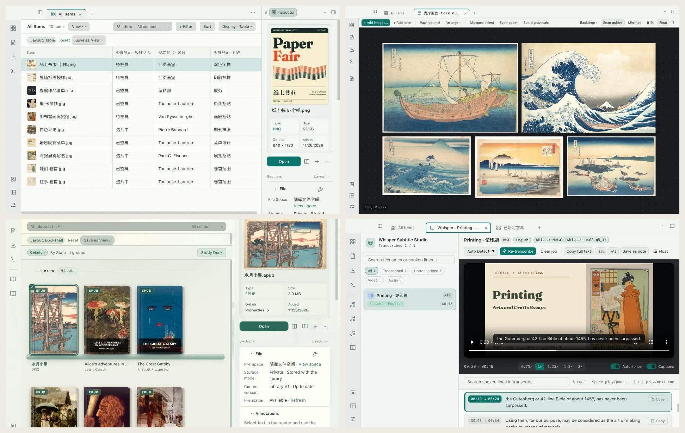
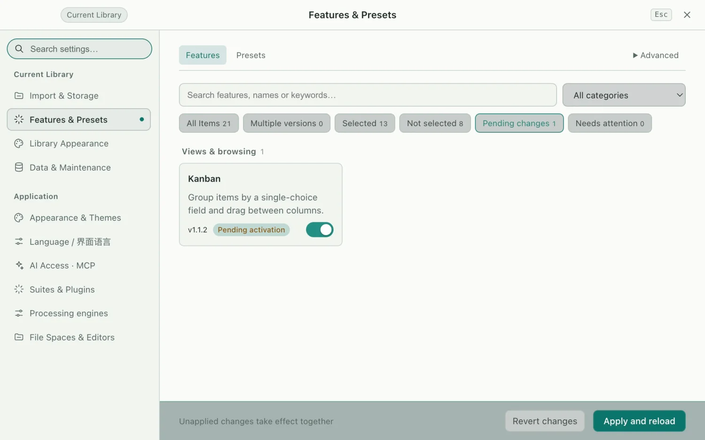
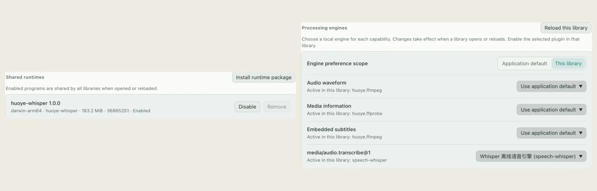
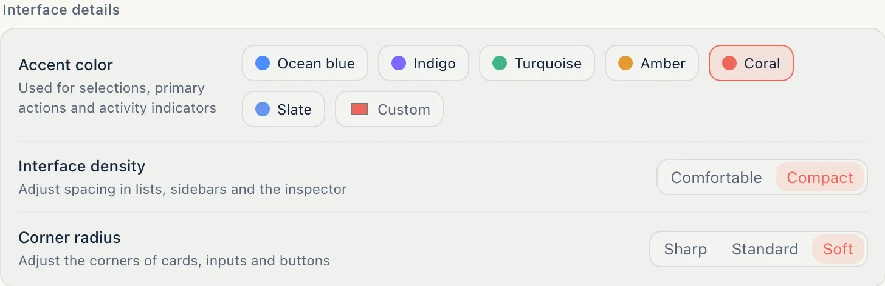

<div align="center">

<picture>
  <source media="(prefers-color-scheme: dark)" srcset="docs/assets/huoye-lockup-dark.svg" />
  <source media="(prefers-color-scheme: light)" srcset="docs/assets/huoye-lockup-light.svg" />
  
</picture>

**Huoye Official Extensions · `huoye-extensions`**

[简体中文](README.md) | English · [Huoye Core Repo](https://github.com/XinXingNOVA/huoye) · [Web Catalog](https://huoye.org/en/catalog) · [Download v0.1.0](https://github.com/XinXingNOVA/huoye-extensions/releases/tag/v0.1.0)

[](https://github.com/XinXingNOVA/huoye-extensions/releases/tag/v0.1.0)
[](https://github.com/XinXingNOVA/huoye/releases)
[](https://github.com/XinXingNOVA/huoye/blob/main/LICENSE)

[Install Guide](#how-to-install-in-3-minutes) · [8 Suites](#suites-8) · [Runtimes](#shared-runtimes-2) · [Themes](#themes-1) · [38 Plugins](#standalone-plugins-38)

</div>

---

<picture>
  <source media="(prefers-color-scheme: dark)" srcset="docs/assets/preview-suites-dark-en.webp" />
  <source media="(prefers-color-scheme: light)" srcset="docs/assets/preview-suites-light-en.webp" />
  
</picture>

Official extension releases for **Huoye**, versioned independently from the core app (current release `v0.1.0`):

- **8 Suites (`.hysuite`)** — curated plugin bundles with ready-to-use split layouts (**recommended starting point**);
- **2 Shared Runtimes (`.hyruntime`)** — offline native models and runners imported once and shared across libraries;
- **1 Standalone Theme (`.hytheme`)** — pure declarative styling (4 built-in themes plus Cyanotype & Ginkgo Autumn examples ship with the core repo);
- **38 Standalone Plugins (`.hyplugin`)** — install individually to customize any library.

> All files are published under [Releases (v0.1.0)](https://github.com/XinXingNOVA/huoye-extensions/releases/tag/v0.1.0) with [`SHA256SUMS.txt`](https://github.com/XinXingNOVA/huoye-extensions/releases/download/v0.1.0/SHA256SUMS.txt).

---

## How to Install in 3 Minutes

Huoye separates **installing on your machine** from **enabling inside a library**: installed packs stay light and never clutter other libraries, and disabling or removing a plugin never erases your data.

### 1. Suites (`.hysuite`) & Plugins (`.hyplugin`)

1. Open **Settings → Suites & Plugins** (or drop a suite onto the Start page) and choose **Install Suite or Plugin…** (or drag the `.hysuite` / `.hyplugin` file in);
2. Review the preview and confirm installation;
3. Open your target library → **Settings → Features & Presets**, toggle the plugins (or apply a suite preset), and click **Apply & Reload**.

<picture>
  <source media="(prefers-color-scheme: dark)" srcset="docs/assets/guide-plugins-dark-en.webp" />
  <source media="(prefers-color-scheme: light)" srcset="docs/assets/guide-plugins-light-en.webp" />
  
</picture>

### 2. Shared Runtimes (`.hyruntime`) & Compute Engines

Only needed for **offline bilingual text-to-image search (Chinese-CLIP)** or **offline speech transcription (Whisper)**:

1. Open **Settings → Compute Engines → Shared Runtimes**, import the `.hyruntime` archive, and enable it once for all libraries;
2. Under **Library Overrides** on the same page, pick your preferred provider (e.g. `speech-whisper` or `embed-clip`) and reload the library.

<picture>
  <source media="(prefers-color-scheme: dark)" srcset="docs/assets/guide-runtime-dark-en.webp" />
  <source media="(prefers-color-scheme: light)" srcset="docs/assets/guide-runtime-light-en.webp" />
  
</picture>

### 3. Themes (`.hytheme`) & Per-Library Appearance

1. Open **Settings → Appearance → Themes** and click **Install Theme…** to import a `.hytheme` file;
2. Select the theme card and optionally tune day/night mode, accent color, density, corners, and wallpaper per library.

<picture>
  <source media="(prefers-color-scheme: dark)" srcset="docs/assets/guide-theme-dark-en.webp" />
  <source media="(prefers-color-scheme: light)" srcset="docs/assets/guide-theme-light-en.webp" />
  
</picture>

> **Trust note**: `.hytheme` packs are purely declarative with no code execution; `.hyplugin`, `.hysuite`, and `.hyruntime` packages are trusted local extensions without a malicious-code sandbox — install only from official Releases or trusted sources and verify `SHA256SUMS.txt`.

---

## Suites (8)

| Suite | Focus | Platform | Presets | Size | Download |
| :--- | :--- | :--- | :--- | ---: | :--- |
| **Atelier Studio**<br/>`atelier-studio` | Art / Photo / Review | Cross-platform | Atelier Studio / Creator All-in-One | 2.7 MB | [Download .hysuite](https://github.com/XinXingNOVA/huoye-extensions/releases/download/v0.1.0/atelier-studio-0.1.0.hysuite) |
| **Visual Search & Vision**<br/>`visual-search` | Search / OCR / Cutout | Cross-platform | Visual Search / Vision Studio / Full Vision Desk | 2.3 MB | [Download .hysuite](https://github.com/XinXingNOVA/huoye-extensions/releases/download/v0.1.0/visual-search-0.1.0.hysuite) |
| **Design Studio**<br/>`design-studio` | Fonts / PSD / SVG / 3D | Cross-platform | Visual Asset Library / Font Studio / Design Ledger | 2.8 MB | [Download .hysuite](https://github.com/XinXingNOVA/huoye-extensions/releases/download/v0.1.0/design-studio-0.1.0.hysuite) |
| **Celadon Study**<br/>`reading-library` | Books / Comics / Highlights | Cross-platform | Celadon Study / Book Ledger / Deep Reading & Highlights | 3.3 MB | [Download .hysuite](https://github.com/XinXingNOVA/huoye-extensions/releases/download/v0.1.0/reading-library-0.1.0.hysuite) |
| **Screening & Transcript Studio**<br/>`media-studio` | Film / Vinyl / Subtitles / Cut | Cross-platform | Screening Room / Vinyl Hall / Offline Transcription & Search / Storyboards & Lossless Trim | 2.4 MB | [Download .hysuite](https://github.com/XinXingNOVA/huoye-extensions/releases/download/v0.1.0/media-studio-0.1.0.hysuite) |
| **Documents & Archives Studio**<br/>`doc-studio` | Office / PDF / Archives / Data | Cross-platform | Document Reading & Search / PDF Surgery & Finishing / Archive Peek & Data Tables | 2.9 MB | [Download .hysuite](https://github.com/XinXingNOVA/huoye-extensions/releases/download/v0.1.0/doc-studio-0.1.0.hysuite) |
| **Forge Studio**<br/>`forge-studio` | Convert / Sheets / Sprites | Cross-platform | Forge Studio / Forge Pro | 2.4 MB | [Download .hysuite](https://github.com/XinXingNOVA/huoye-extensions/releases/download/v0.1.0/forge-studio-0.1.0.hysuite) |
| **Vault Insight**<br/>`vault-insight` | Link Graph / Health Audit | Cross-platform | Graph & Health / Full Graph | 2.2 MB | [Download .hysuite](https://github.com/XinXingNOVA/huoye-extensions/releases/download/v0.1.0/vault-insight-0.1.0.hysuite) |

<details>
<summary>Full suite descriptions & platform notes</summary>

- **Atelier Studio** (`atelier-studio` · v0.1.0 · 18 plugins): Offline visual review studio for artists and photographers: seeded shuffle and color-spectrum browsing, darkroom loupe with synced 2–4 image wipe comparison, plus histograms, EXIF, and AI prompt search. *(Cross-platform (Apple Vision on macOS, Classic engine elsewhere))*
- **Visual Search & Vision** (`visual-search` · v0.1.0 · 16 plugins): Unites reverse image search, bilingual text-to-image search, visual deduplication, Live Text OCR, and one-click subject cutouts with hot-swappable local vision engines. *(Cross-platform (Apple Vision on macOS; Chinese-CLIP runtime enables text-to-image))*
- **Design Studio** (`design-studio` · v0.1.0 · 16 plugins): Visual design asset desk featuring a live type specimen wall, local PSD/PSB layer inspection, safe SVG recoloring, WebGL2 3D turntable, and PureBoard. *(Cross-platform)*
- **Celadon Study** (`reading-library` · v0.1.0 · 15 plugins): Personal reading room for EPUB, Kindle, PDF, comics, and long TXT files — with a tactile bookshelf, book catalog table, and highlights that jump back to the exact passage. *(Cross-platform)*
- **Screening & Transcript Studio** (`media-studio` · v0.1.0 · 14 plugins): Combines Cine Room, Vinyl Deck, offline Whisper transcription, and lossless clip cutting — switch presets between film study, Hi-Fi listening, subtitle search, and storyboard trimming. *(Cross-platform (offline transcription requires the Whisper runtime))*
- **Documents & Archives Studio** (`doc-studio` · v0.1.0 · 15 plugins): Offline desk for office files, spreadsheets, and archives: Word/PPT/RTF reading and full-text search, PDF surgery, no-extract archive peeking, and 100k-row data tables. *(Cross-platform (PDF Forge uses macOS PDFKit))*
- **Forge Studio** (`forge-studio` · v0.1.0 · 14 plugins): Offline batch production trio: image/media format conversion, long-image stitching and contact sheets/PDF albums, and grid slicing/sprite sheets — all with direct-to-disk export. *(Cross-platform)*
- **Vault Insight** (`vault-insight` · v0.1.0 · 13 plugins): Map and maintain large libraries with an interactive relation graph across links, tags, and similarity, paired with treemap storage analysis and exact duplicate cleanup. *(Cross-platform)*

</details>

---

## Shared Runtimes (2)

| Runtime | Target | Pairs With | Size | Download |
| :--- | :--- | :--- | ---: | :--- |
| **Chinese-CLIP ViT-B/16 Runtime**<br/>`huoye-cn-clip-0.1.0-darwin-arm64.hyruntime` | macOS Apple Silicon | `embed-clip` `visual-search` `atelier-studio` | 225.5 MB | [Download .hyruntime](https://github.com/XinXingNOVA/huoye-extensions/releases/download/v0.1.0/huoye-cn-clip-0.1.0-darwin-arm64.hyruntime) |
| **Whisper Local Speech Runtime**<br/>`huoye-whisper-0.1.0-darwin-arm64.hyruntime` | macOS Apple Silicon | `speech-whisper` `whisper-studio` `media-studio` | 183.2 MB | [Download .hyruntime](https://github.com/XinXingNOVA/huoye-extensions/releases/download/v0.1.0/huoye-whisper-0.1.0-darwin-arm64.hyruntime) |

- **Chinese-CLIP ViT-B/16 Runtime**: Self-contained quantized ONNX weights and native runner for offline Chinese/English text-to-image search across libraries — zero Python setup.
- **Whisper Local Speech Runtime**: Metal-accelerated whisper.cpp with quantized multilingual weights for fully offline timestamped speech transcription.

---

## Themes (1)

| Theme | Mode | Size | Summary | Download |
| :--- | :--- | ---: | :--- | :--- |
| **Hakurei Shrine**<br/>`hakurei-shrine-0.1.0.hytheme` | Day & Night | 210 KB | Warm washi paper and vermilion accents by day, deep twilight shrine tones by night — complete with custom icons and subtle textures. | [Download .hytheme](https://github.com/XinXingNOVA/huoye-extensions/releases/download/v0.1.0/hakurei-shrine-0.1.0.hytheme) |

> Note: Huoye also includes 4 built-in day/night themes plus **Cyanotype** and **Ginkgo Autumn** example packs in the core repo under `host/examples/themes/`.

---

## Standalone Plugins (38)

> If you already installed a Suite above, its plugins are bundled automatically. Use standalone packages when mixing and matching.

| Plugin | ID | Category | Platform | Size | Summary | Download |
| :--- | :--- | :--- | :--- | ---: | :--- | :--- |
| **Creative Browse** | `creative-browse` | Visual & Studio | Cross-platform | 41 KB | Explore image libraries via seeded shuffle, color spectrum rivers, similarity chains, and aspect-ratio rhythm. | [.hyplugin](https://github.com/XinXingNOVA/huoye-extensions/releases/download/v0.1.0/creative-browse-0.1.0.hyplugin) |
| **Image Audit** | `image-audit` | Visual & Studio | Cross-platform | 312 KB | Inspect histograms, polar color wheels, pixel values, texture alignment, camera EXIF, and indexed AI generation prompts. | [.hyplugin](https://github.com/XinXingNOVA/huoye-extensions/releases/download/v0.1.0/image-audit-0.1.0.hyplugin) |
| **Loupe Viewer** | `loupe-viewer` | Visual & Studio | Cross-platform | 62 KB | Darkroom loupe with pixel grid, mirror/grayscale checks, composition guides, synced 2–4 image wipe compare, and timed gesture practice. | [.hyplugin](https://github.com/XinXingNOVA/huoye-extensions/releases/download/v0.1.0/loupe-viewer-0.1.0.hyplugin) |
| **PureBoard** | `pureboard` | Visual & Studio | Cross-platform | 298 KB | Infinite reference canvas with rotation, cropping, eyedropper, notes, auto-packing, and frameless always-on-top floating windows. | [.hyplugin](https://github.com/XinXingNOVA/huoye-extensions/releases/download/v0.1.0/pureboard-0.1.0.hyplugin) |
| **Vision Studio** | `vision-studio` | Visual & Studio | Cross-platform | 285 KB | Live Text OCR and one-click subject cutout desk: search and copy text inside images and export full-resolution transparent PNGs. | [.hyplugin](https://github.com/XinXingNOVA/huoye-extensions/releases/download/v0.1.0/vision-studio-0.1.0.hyplugin) |
| **Visual Search** | `visual-search` | Visual & Studio | Cross-platform | 313 KB | Offline reverse image search, bilingual text-to-image search, zero-ingest drag search, similar-item sidebar, and visual deduplication. | [.hyplugin](https://github.com/XinXingNOVA/huoye-extensions/releases/download/v0.1.0/visual-search-0.1.0.hyplugin) |
| **Font Studio** | `font-studio` | Design | Cross-platform | 311 KB | Type specimen wall for TTF/OTF/WOFF/WOFF2 with variable axes, glyph tables, overlay comparison, and license notes. | [.hyplugin](https://github.com/XinXingNOVA/huoye-extensions/releases/download/v0.1.0/font-studio-0.1.0.hyplugin) |
| **PSD Layer Studio** | `psd-studio` | Design | Cross-platform | 294 KB | Inspect PSD/PSB layer trees locally without Photoshop, toggle visibility, isolate layers, and export full-res PNGs. | [.hyplugin](https://github.com/XinXingNOVA/huoye-extensions/releases/download/v0.1.0/psd-studio-0.1.0.hyplugin) |
| **SVG Studio** | `svg-studio` | Design | Cross-platform | 304 KB | Safe SVG inspection with wireframe and multi-size previews, live recoloring, minification, and React/CSS/PNG export. | [.hyplugin](https://github.com/XinXingNOVA/huoye-extensions/releases/download/v0.1.0/svg-studio-0.1.0.hyplugin) |
| **3D Mesh Viewer** | `mesh-viewer` | Design | Cross-platform | 325 KB | Preview GLB, glTF, STL, and OBJ models with automatic studio thumbnails, four shading modes, and a floating turntable. | [.hyplugin](https://github.com/XinXingNOVA/huoye-extensions/releases/download/v0.1.0/mesh-viewer-0.1.0.hyplugin) |
| **EPUB Reader** | `epub` | Reading | Cross-platform | 462 KB | Paginated and two-page EPUB reader with paper themes, footnote popovers, image lightbox, full-book search, and note export. | [.hyplugin](https://github.com/XinXingNOVA/huoye-extensions/releases/download/v0.1.0/epub-0.1.0.hyplugin) |
| **Multi-Format E-book Reader** | `ebook-reader` | Reading | Cross-platform | 348 KB | Read MOBI, AZW3, KF8, FB2, DOCX, and MHTML offline with spread layout, full-text search, and read-aloud. | [.hyplugin](https://github.com/XinXingNOVA/huoye-extensions/releases/download/v0.1.0/ebook-reader-0.1.0.hyplugin) |
| **Long-Form TXT Reader** | `txt-reader` | Reading | Cross-platform | 297 KB | Auto-detects text encodings and splits chapters for long novels with spread pagination, search, and bookmarks. | [.hyplugin](https://github.com/XinXingNOVA/huoye-extensions/releases/download/v0.1.0/txt-reader-0.1.0.hyplugin) |
| **Comic & Artbook Reader** | `comic` | Reading | Cross-platform | 303 KB | Read CBZ, CBT, CBR, and image sets in single-page, RTL manga spread, or vertical strip modes with single-page capture. | [.hyplugin](https://github.com/XinXingNOVA/huoye-extensions/releases/download/v0.1.0/comic-0.1.0.hyplugin) |
| **Bookshelf & Study** | `bookshelf` | Reading | Cross-platform | 45 KB | Tactile bookshelf layout and study home organizing books by status, author, or series alongside reading progress. | [.hyplugin](https://github.com/XinXingNOVA/huoye-extensions/releases/download/v0.1.0/bookshelf-0.1.0.hyplugin) |
| **Book Metadata** | `book-meta` | Reading | Cross-platform | 271 KB | Unified book catalog fields across ebooks, PDFs, and comics with reading status, time tracking, and a Year Wall. | [.hyplugin](https://github.com/XinXingNOVA/huoye-extensions/releases/download/v0.1.0/book-meta-0.1.0.hyplugin) |
| **Highlights Hub** | `highlights` | Reading | Cross-platform | 295 KB | Collects all reading excerpts with daily flashcard review, shareable quote cards, and one-click jump back to source. | [.hyplugin](https://github.com/XinXingNOVA/huoye-extensions/releases/download/v0.1.0/highlights-0.1.0.hyplugin) |
| **Cine Room Player** | `cine-player` | Media & Speech | Cross-platform | 345 KB | Film-study video player with frame stepping, A-B loop, embedded multilingual subtitles, shot markers, and dual-video wipe compare. | [.hyplugin](https://github.com/XinXingNOVA/huoye-extensions/releases/download/v0.1.0/cine-player-0.1.0.hyplugin) |
| **Vinyl Deck Audio** | `vinyl-audio` | Media & Speech | Cross-platform | 336 KB | Hi-Fi music and podcast player with turntable animation, real waveforms, synced lyrics, 10-band EQ, and audio bookmarks. | [.hyplugin](https://github.com/XinXingNOVA/huoye-extensions/releases/download/v0.1.0/vinyl-audio-0.1.0.hyplugin) |
| **Media Wall & Hub** | `media-shelf` | Media & Speech | Cross-platform | 52 KB | Adaptive 1:1 vinyl and 16:9 cinema browsing wall with hover video scrubbing, album grouping, and resume cards. | [.hyplugin](https://github.com/XinXingNOVA/huoye-extensions/releases/download/v0.1.0/media-shelf-0.1.0.hyplugin) |
| **Whisper Subtitle Studio** | `whisper-studio` | Media & Speech | Cross-platform | 290 KB | On-demand offline speech transcription with searchable global cues, click-to-seek playback, and SRT/VTT/Markdown export. | [.hyplugin](https://github.com/XinXingNOVA/huoye-extensions/releases/download/v0.1.0/whisper-studio-0.1.0.hyplugin) |
| **Clip Cutter** | `clip-cutter` | Media & Speech | Cross-platform | 70 KB | Lossless timeline trimming, automatic scene breakdown, and HD storyboards — save to your library or export straight to disk. | [.hyplugin](https://github.com/XinXingNOVA/huoye-extensions/releases/download/v0.1.0/clip-cutter-0.1.0.hyplugin) |
| **Office Lens** | `office-lens` | Docs & Data | Cross-platform | 328 KB | Read DOCX, PPTX (with speaker notes), and Chinese RTF offline with automatic full-text search, Markdown capture, and direct export. | [.hyplugin](https://github.com/XinXingNOVA/huoye-extensions/releases/download/v0.1.0/office-lens-0.1.0.hyplugin) |
| **PDF Forge** | `pdf-forge` | Docs & Data | macOS only | 77 KB | Merge, reorder, rotate, split, watermark, render, and extract text from PDFs using macOS PDFKit — with library or direct export. | [.hyplugin](https://github.com/XinXingNOVA/huoye-extensions/releases/download/v0.1.0/pdf-forge-0.1.0.hyplugin) |
| **Archive Peek** | `archive-peek` | Docs & Data | Cross-platform | 317 KB | Browse and search inside ZIP, TAR, and TAR.GZ archives without unpacking, preview contents, and extract selectively. | [.hyplugin](https://github.com/XinXingNOVA/huoye-extensions/releases/download/v0.1.0/archive-peek-0.1.0.hyplugin) |
| **Data Lens** | `data-lens` | Docs & Data | Cross-platform | 314 KB | Explore 100k-row CSV, TSV, XLSX, and JSON files with column histograms, filtering, interactive charts, and format export. | [.hyplugin](https://github.com/XinXingNOVA/huoye-extensions/releases/download/v0.1.0/data-lens-0.1.0.hyplugin) |
| **Format Forge** | `format-forge` | Batch & Hygiene | Cross-platform | 89 KB | Batch image compression, format conversion, watermarks, and FFmpeg video/audio transcoding with library or direct export. | [.hyplugin](https://github.com/XinXingNOVA/huoye-extensions/releases/download/v0.1.0/format-forge-0.1.0.hyplugin) |
| **Sheet Studio** | `sheet-studio` | Batch & Hygiene | Cross-platform | 64 KB | Stitch long images, build numbered darkroom contact sheets with EXIF labels, and assemble multi-page PDF albums. | [.hyplugin](https://github.com/XinXingNOVA/huoye-extensions/releases/download/v0.1.0/sheet-studio-0.1.0.hyplugin) |
| **Sprite Slicer** | `sprite-slicer` | Batch & Hygiene | Cross-platform | 76 KB | Slice grids with empty-tile skipping and pack game sprite sheets with animation preview and TexturePacker/CSS coordinates. | [.hyplugin](https://github.com/XinXingNOVA/huoye-extensions/releases/download/v0.1.0/sprite-slicer-0.1.0.hyplugin) |
| **Link Graph** | `link-graph` | Batch & Hygiene | Cross-platform | 60 KB | Interactive force-directed graph uniting links, annotations, folders, tags, and visual similarity, with local sidebar and orphan detection. | [.hyplugin](https://github.com/XinXingNOVA/huoye-extensions/releases/download/v0.1.0/link-graph-0.1.0.hyplugin) |
| **Vault Doctor** | `vault-doctor` | Batch & Hygiene | Cross-platform | 59 KB | Treemap storage analyzer with exact duplicate detection, failed-task retry, orphan diagnostics, and SQLite compaction. | [.hyplugin](https://github.com/XinXingNOVA/huoye-extensions/releases/download/v0.1.0/vault-doctor-0.1.0.hyplugin) |
| **View Bucket** | `view-bucket` | Batch & Hygiene | Cross-platform | 237 KB | Turn any saved view into a floating drop box that automatically tags and files dragged or pasted items. | [.hyplugin](https://github.com/XinXingNOVA/huoye-extensions/releases/download/v0.1.0/view-bucket-0.1.0.hyplugin) |
| **Apple Vision Embedding Engine** | `embed-apple` | Compute Engines | macOS only | 28 KB | Uses macOS Vision framework locally for zero-setup 768D visual embeddings powering reverse image search and similarity browsing. | [.hyplugin](https://github.com/XinXingNOVA/huoye-extensions/releases/download/v0.1.0/embed-apple-0.1.0.hyplugin) |
| **Classic Visual Feature Engine** | `embed-classic` | Compute Engines | Cross-platform | 31 KB | Pure TypeScript cross-platform visual feature engine enabling similarity search and deduplication with zero native dependencies. | [.hyplugin](https://github.com/XinXingNOVA/huoye-extensions/releases/download/v0.1.0/embed-classic-0.1.0.hyplugin) |
| **Chinese-CLIP Semantic Engine** | `embed-clip` | Compute Engines | Cross-platform | 29 KB | Pairs with the huoye-cn-clip shared runtime to power offline Chinese & English text-to-image and cross-modal search. | [.hyplugin](https://github.com/XinXingNOVA/huoye-extensions/releases/download/v0.1.0/embed-clip-0.1.0.hyplugin) |
| **Apple Vision OCR & Cutout Engine** | `vision-apple` | Compute Engines | macOS only | 25 KB | Uses macOS Vision locally for high-accuracy multilingual OCR and foreground subject cutouts in Vision Studio. | [.hyplugin](https://github.com/XinXingNOVA/huoye-extensions/releases/download/v0.1.0/vision-apple-0.1.0.hyplugin) |
| **Tesseract OCR Engine** | `vision-tesseract` | Compute Engines | Cross-platform | 9 KB | Cross-platform OCR capability provider backed by local Tesseract for Vision Studio on macOS, Windows, and Linux. | [.hyplugin](https://github.com/XinXingNOVA/huoye-extensions/releases/download/v0.1.0/vision-tesseract-0.1.0.hyplugin) |
| **Whisper Speech Engine** | `speech-whisper` | Compute Engines | Cross-platform | 27 KB | Pairs with the huoye-whisper shared runtime to provide offline multilingual speech-to-text for Whisper Subtitle Studio. | [.hyplugin](https://github.com/XinXingNOVA/huoye-extensions/releases/download/v0.1.0/speech-whisper-0.1.0.hyplugin) |

---

## Verify Checksums

```bash
# macOS / Linux
shasum -a 256 -c SHA256SUMS.txt --ignore-missing

# Windows PowerShell
Get-FileHash .\atelier-studio-0.1.0.hysuite -Algorithm SHA256
```

---

## License & Feedback

- Extension plugin code and build scripts are licensed under Apache-2.0. Native runners and model weights inside `.hyruntime` archives retain their upstream licenses (bundled under `licenses/`).
- Report bugs or requests in [Huoye Core Issues](https://github.com/XinXingNOVA/huoye/issues) or visit [huoye.org](https://huoye.org/en/).
