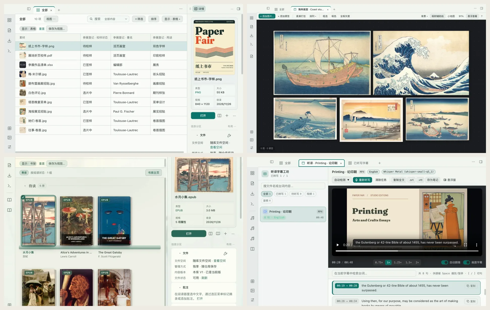
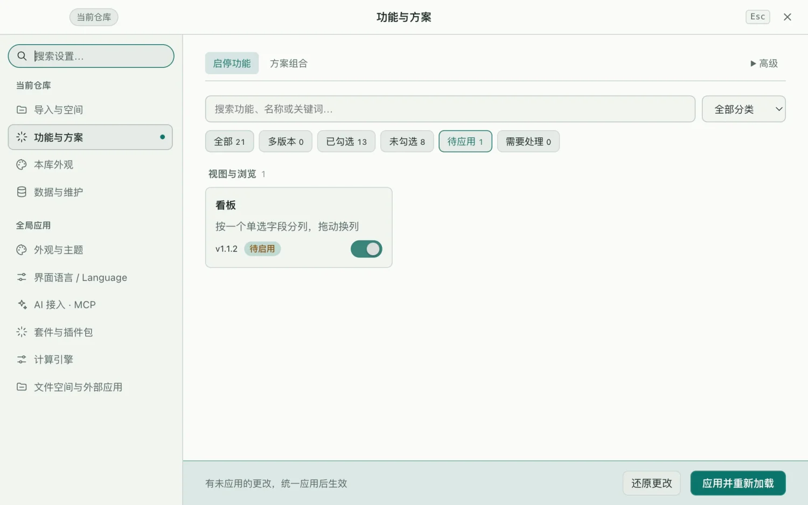
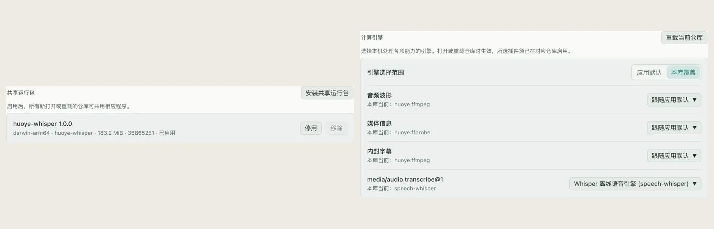
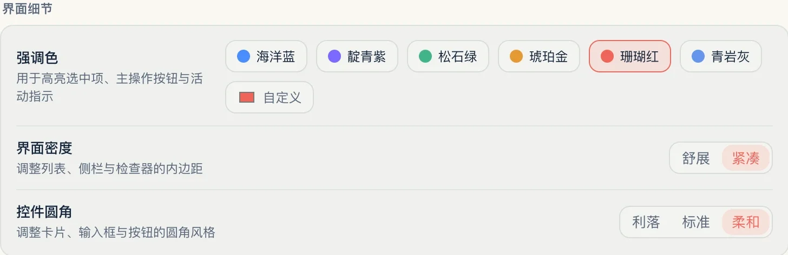

<div align="center">

<picture>
  <source media="(prefers-color-scheme: dark)" srcset="docs/assets/huoye-lockup-dark.svg" />
  <source media="(prefers-color-scheme: light)" srcset="docs/assets/huoye-lockup-light.svg" />
  
</picture>

**活页官方扩展仓库 · `huoye-extensions`**

简体中文 | [English](README.en.md) · [活页主仓库](https://github.com/XinXingNOVA/huoye) · [官网扩展馆](https://huoye.org/catalog) · [下载 v0.1.0 产物](https://github.com/XinXingNOVA/huoye-extensions/releases/tag/v0.1.0)

[](https://github.com/XinXingNOVA/huoye-extensions/releases/tag/v0.1.0)
[](https://github.com/XinXingNOVA/huoye/releases)
[](https://github.com/XinXingNOVA/huoye/blob/main/LICENSE)

[安装图解](#三分钟学会安装四种内页) · [8 套场景套件](#场景套件8-套) · [离线运行包](#离线共享运行包2-个) · [独立主题](#独立主题1-套) · [38 个单装插件](#单装插件38-个)

</div>

---

<picture>
  <source media="(prefers-color-scheme: dark)" srcset="docs/assets/preview-suites-dark-zh.webp" />
  <source media="(prefers-color-scheme: light)" srcset="docs/assets/preview-suites-light-zh.webp" />
  
</picture>

本仓库专门集中发布 **活页（Huoye）** 的官方扩展产物，与主程序版本解耦，方便独立迭代与按需下载（当前发布版本 `v0.1.0`）：

- **8 套场景套件（`.hysuite`）**：按工作现场打包整套插件与分屏预设，**新手推荐直接从套件起步**；
- **2 个离线共享运行包（`.hyruntime`）**：重型本地模型与原生推理程序，导入一次跨仓库共用；
- **1 套独立主题（`.hytheme`）**：纯声明式外观包（另有 4 套内置主题及主仓 `host/examples/themes/` 附带的「银杏·秋光」「蓝晒」2 套示例主题）；
- **38 个单装插件（`.hyplugin`）**：进阶用户按需单装或自由拼装。

> 所有文件均可在 [Releases (v0.1.0)](https://github.com/XinXingNOVA/huoye-extensions/releases/tag/v0.1.0) 直接下载，并附带 [`SHA256SUMS.txt`](https://github.com/XinXingNOVA/huoye-extensions/releases/download/v0.1.0/SHA256SUMS.txt) 供核对校验和。

---

## 三分钟学会安装四种内页

活页采用「**先安装到本机，再按仓库自由启停**」机制：装好的套件、插件和主题不会强行塞满你原有的每一个仓库，停用或卸载插件也不会删掉你的数据。

### 1. 安装场景套件（`.hysuite`）与单装插件（`.hyplugin`）

1. 在活页打开 **「设置 → 套件与插件包」**（新建仓库时也可在开始页直接导入套件），点击 **「安装套件或插件包…」** 或直接把 `.hysuite` / `.hyplugin` 文件拖进窗口；
2. 核对预览中的名称、版本与依赖后确认安装；
3. 打开目标仓库，进入 **「设置 → 功能与方案 → 启停功能」**，勾选刚装好的插件（或直接套用套件预设），点 **「应用并重新加载」** 即刻生效。

<picture>
  <source media="(prefers-color-scheme: dark)" srcset="docs/assets/guide-plugins-dark-zh.webp" />
  <source media="(prefers-color-scheme: light)" srcset="docs/assets/guide-plugins-light-zh.webp" />
  
</picture>

### 2. 导入离线共享运行包（`.hyruntime`）并切换算力引擎

仅在需要 **中英文自然语言文搜图（Chinese-CLIP）** 或 **离线语音转字幕（Whisper）** 时安装，不装不影响主程序：

1. 打开 **「设置 → 计算引擎 → 共享运行包」**，导入下载好的 `.hyruntime` 文件并点击启用（导入一次，本机所有仓库共用）；
2. 在同一页面的 **「本库覆盖」** 中，为对应能力选定想用的引擎（如给语音转写选定 `speech-whisper`、给视觉特征选定 `embed-clip`），保存并重载仓库即可。

<picture>
  <source media="(prefers-color-scheme: dark)" srcset="docs/assets/guide-runtime-dark-zh.webp" />
  <source media="(prefers-color-scheme: light)" srcset="docs/assets/guide-runtime-light-zh.webp" />
  
</picture>

### 3. 导入独立主题包（`.hytheme`）与微调外观

1. 打开 **「设置 → 外观与主题」**，点击 **「安装主题包…」** 选择 `.hytheme` 文件；
2. 点击已安装主题卡片即可切换，并可在当前仓库自由调整昼夜模式、强调色、密度、圆角与壁纸，各仓库互不干扰。

<picture>
  <source media="(prefers-color-scheme: dark)" srcset="docs/assets/guide-theme-dark-zh.webp" />
  <source media="(prefers-color-scheme: light)" srcset="docs/assets/guide-theme-light-zh.webp" />
  
</picture>

> **安全提示**：`.hytheme` 为纯声明式零执行权限；`.hyplugin` / `.hysuite` / `.hyruntime` 属于本地可信扩展，请仅从官方 Release 或信任来源下载，并用 `SHA256SUMS.txt` 核对完整性。

---

## 场景套件（8 套）

| 套件 | 场景 | 平台 | 内置预设 | 体积 | 下载 |
| :--- | :--- | :--- | :--- | ---: | :--- |
| **画室精审**<br/>`atelier-studio` | 画师 / 摄影 / 美术 | 全平台 | 画室精审 / 创作者全套 | 2.7 MB | [下载 .hysuite](https://github.com/XinXingNOVA/huoye-extensions/releases/download/v0.1.0/atelier-studio-0.1.0.hysuite) |
| **灵图与灵眸**<br/>`visual-search` | 搜图 / OCR / 抠图 | 全平台 | 灵图检索 / 灵眸视觉 / 视觉全能台 | 2.3 MB | [下载 .hysuite](https://github.com/XinXingNOVA/huoye-extensions/releases/download/v0.1.0/visual-search-0.1.0.hysuite) |
| **设计工坊**<br/>`design-studio` | 字体 / PSD / SVG / 3D | 全平台 | 综合设计资产库 / 字体馆 / 设计台账 | 2.8 MB | [下载 .hysuite](https://github.com/XinXingNOVA/huoye-extensions/releases/download/v0.1.0/design-studio-0.1.0.hysuite) |
| **青瓷书房**<br/>`reading-library` | 电子书 / 漫画 / 书摘 | 全平台 | 青瓷书房 / 书目台账 / 精读与书摘工作台 | 3.3 MB | [下载 .hysuite](https://github.com/XinXingNOVA/huoye-extensions/releases/download/v0.1.0/reading-library-0.1.0.hysuite) |
| **黑胶放映与听译**<br/>`media-studio` | 拉片 / 黑胶 / 听译 / 快剪 | 全平台 | 黑胶放映室 / 黑胶唱片馆 / 离线听译与台词检索 / 拉片分镜与无损快剪 | 2.4 MB | [下载 .hysuite](https://github.com/XinXingNOVA/huoye-extensions/releases/download/v0.1.0/media-studio-0.1.0.hysuite) |
| **办公与档案工坊**<br/>`doc-studio` | Office / PDF / 压缩包 / 表格 | 全平台 | 文档精读与全文检索 / PDF 手术与批量加工 / 压缩包透视与表格分析 | 2.9 MB | [下载 .hysuite](https://github.com/XinXingNOVA/huoye-extensions/releases/download/v0.1.0/doc-studio-0.1.0.hysuite) |
| **效率魔方**<br/>`forge-studio` | 批转 / 联系表 / 切图 | 全平台 | 效率魔方 / 制作全能台 | 2.4 MB | [下载 .hysuite](https://github.com/XinXingNOVA/huoye-extensions/releases/download/v0.1.0/forge-studio-0.1.0.hysuite) |
| **仓库洞察**<br/>`vault-insight` | 关系星图 / 空间体检 | 全平台 | 星图与体检 / 全维星图 | 2.2 MB | [下载 .hysuite](https://github.com/XinXingNOVA/huoye-extensions/releases/download/v0.1.0/vault-insight-0.1.0.hysuite) |

<details>
<summary>展开查看 8 套套件的完整说明与平台备注</summary>

- **画室精审** (`atelier-studio` · v0.1.0 · 含 18 个插件)：面向画师与摄影师的离线看图与灵感工作台：随机洗牌与色彩光谱漫游、暗房级逐像素精审与多图卷帘对比，内置直方图、EXIF 与 AI 生成参数检索。（全平台（视觉引擎在 macOS 默认走 Apple Vision，其他系统可切经典特征））
- **灵图与灵眸** (`visual-search` · v0.1.0 · 含 16 个插件)：把以图搜图、中英文自然语言文搜图、视觉去重、实况文本 OCR 与一键透明抠图合在一套，按需挂载或热切换本地视觉引擎。（全平台（macOS 开箱可用 Apple Vision；文搜图需导入 Chinese-CLIP 运行包））
- **设计工坊** (`design-studio` · v0.1.0 · 含 16 个插件)：面向品牌与视觉设计的资产工作台：字体试打墙与可变轴、PSD/PSB 图层审稿、SVG 图标调色、3D 模型展台与灵感参考板。（全平台）
- **青瓷书房** (`reading-library` · v0.1.0 · 含 15 个插件)：一站式个人藏书与精读空间：支持 EPUB、Kindle、PDF、漫画画集与长篇 TXT，配备实体书架、书目台账与书摘回跳。（全平台）
- **黑胶放映与听译** (`media-studio` · v0.1.0 · 含 14 个插件)：将放映室、黑胶台、离线语音听译与视频无损快剪合为一套：逐帧拉片、黑胶听音、搜台词直达原声与自动分镜剪辑按预设切换。（全平台（离线语音听译需导入 Whisper 运行包））
- **办公与档案工坊** (`doc-studio` · v0.1.0 · 含 15 个插件)：面向日常文档、数据表与归档包的全离线工作台：直读 Word/PPT/RTF 与全文检索、PDF 合并拆分水印、压缩包免解压检索以及十万行表格分析。（全平台（其中 PDF 手术台依赖 macOS 原生 PDFKit））
- **效率魔方** (`forge-studio` · v0.1.0 · 含 14 个插件)：离线批量加工三件套：图片与音视频格式转换压制、长图拼接与暗房联系表/PDF 画册、九宫格切图与游戏精灵图合图，均支持不入库直出。（全平台）
- **仓库洞察** (`vault-insight` · v0.1.0 · 含 13 个插件)：看清大型仓库的脉络与冗余：用交互式关系星图梳理双链、标签与相似素材，用空间树图排查大文件、精确重复项与孤岛资产。（全平台）

</details>

---

## 离线共享运行包（2 个）

| 运行包 | 目标平台 | 配套套件 / 插件 | 体积 | 下载 |
| :--- | :--- | :--- | ---: | :--- |
| **Chinese-CLIP 中文语义视觉运行包**<br/>`huoye-cn-clip-0.1.0-darwin-arm64.hyruntime` | macOS Apple Silicon | `embed-clip` `visual-search` `atelier-studio` | 225.5 MB | [下载 .hyruntime](https://github.com/XinXingNOVA/huoye-extensions/releases/download/v0.1.0/huoye-cn-clip-0.1.0-darwin-arm64.hyruntime) |
| **Whisper 离线语音听译运行包**<br/>`huoye-whisper-0.1.0-darwin-arm64.hyruntime` | macOS Apple Silicon | `speech-whisper` `whisper-studio` `media-studio` | 183.2 MB | [下载 .hyruntime](https://github.com/XinXingNOVA/huoye-extensions/releases/download/v0.1.0/huoye-whisper-0.1.0-darwin-arm64.hyruntime) |

- **Chinese-CLIP 中文语义视觉运行包**：内置量化 ONNX 模型与原生推理程序，导入一次即可在多个仓库离线开启中英文自然语言文搜图，无需配置 Python。
- **Whisper 离线语音听译运行包**：内置 Metal 加速 whisper.cpp 与多语种量化模型，离线把本地音视频转成带时间码的可检索字幕，数据不出本机。

---

## 独立主题（1 套）

| 主题 | 模式 | 体积 | 说明 | 下载 |
| :--- | :--- | ---: | :--- | :--- |
| **博丽缘侧**<br/>`hakurei-shrine-0.1.0.hytheme` | 昼夜双模 | 210 KB | 和纸与朱绯纸垂的午后神社白昼，翻面即入微芒渐染的暗夜结界；附定制图标与细腻背景纹理。 | [下载 .hytheme](https://github.com/XinXingNOVA/huoye-extensions/releases/download/v0.1.0/hakurei-shrine-0.1.0.hytheme) |

> 另：活页主程序已内置 **活页·标准 / 银盐画册 / 青瓷书房 / 紧凑资料台** 4 套昼夜主题，并在主仓 `host/examples/themes/` 随附 **蓝晒（cyanotype）** 与 **银杏·秋光（ginkgo）** 2 套示例主题。

---

## 单装插件（38 个）

> 若已安装上面的场景套件，无需重复下载对应单装插件；下表供按需单独挑选或搭配自定义仓库使用。

| 插件 | ID | 分类 | 平台 | 体积 | 简介 | 下载 |
| :--- | :--- | :--- | :--- | ---: | :--- | :--- |
| **创意漫游与灵感排序** | `creative-browse` | 视觉与画室 | 全平台 | 41 KB | 以随机种子洗牌、色彩光谱长河、视觉相似度串联与画幅节奏重新浏览图库，适合找灵感与挑片。 | [.hyplugin](https://github.com/XinXingNOVA/huoye-extensions/releases/download/v0.1.0/creative-browse-0.1.0.hyplugin) |
| **图形审计** | `image-audit` | 视觉与画室 | 全平台 | 312 KB | 查看 RGB/明度直方图、极坐标色盘、像素吸管、贴图对齐质检、相机 EXIF，并自动索引 AI 生图参数。 | [.hyplugin](https://github.com/XinXingNOVA/huoye-extensions/releases/download/v0.1.0/image-audit-0.1.0.hyplugin) |
| **画师精审看图与对比台** | `loupe-viewer` | 视觉与画室 | 全平台 | 62 KB | 暗房级看图与选片台：像素网格、镜像灰度、构图参考线、2–4 图同步卷帘对比与速写定时轮播。 | [.hyplugin](https://github.com/XinXingNOVA/huoye-extensions/releases/download/v0.1.0/loupe-viewer-0.1.0.hyplugin) |
| **灵感参考板** | `pureboard` | 视觉与画室 | 全平台 | 298 KB | 无限画布参考板：自由摆放、旋转裁切、吸色便签、紧凑排布，并可撕出为无框置顶小窗。 | [.hyplugin](https://github.com/XinXingNOVA/huoye-extensions/releases/download/v0.1.0/pureboard-0.1.0.hyplugin) |
| **灵眸视觉** | `vision-studio` | 视觉与画室 | 全平台 | 285 KB | 实况文本 OCR 与一键透明主体抠图工作台：图片文字直接入全局搜索与划选复制，抠图原分辨率导出。 | [.hyplugin](https://github.com/XinXingNOVA/huoye-extensions/releases/download/v0.1.0/vision-studio-0.1.0.hyplugin) |
| **灵图检索** | `visual-search` | 视觉与画室 | 全平台 | 313 KB | 离线以图搜图、中英文自然语言文搜图、外图拖入不入库直搜、相似灵感侧栏与三档视觉去重清理。 | [.hyplugin](https://github.com/XinXingNOVA/huoye-extensions/releases/download/v0.1.0/visual-search-0.1.0.hyplugin) |
| **字体馆** | `font-studio` | 设计资产 | 全平台 | 311 KB | 支持 TTF/OTF/WOFF/WOFF2 试打墙、可变轴调节、字形表、同屏叠影比对与商用授权记录。 | [.hyplugin](https://github.com/XinXingNOVA/huoye-extensions/releases/download/v0.1.0/font-studio-0.1.0.hyplugin) |
| **PSD 图层工坊** | `psd-studio` | 设计资产 | 全平台 | 294 KB | 无需 Photoshop 直读 PSD/PSB 图层树与规格，支持图层显隐合成、孤立检视与原分辨率单层导出。 | [.hyplugin](https://github.com/XinXingNOVA/huoye-extensions/releases/download/v0.1.0/psd-studio-0.1.0.hyplugin) |
| **矢量图标工坊** | `svg-studio` | 设计资产 | 全平台 | 304 KB | 安全预览 SVG 矢量图形、线框与多尺寸检查、无损换色、源码精简，并一键复制 React/CSS 或转 PNG。 | [.hyplugin](https://github.com/XinXingNOVA/huoye-extensions/releases/download/v0.1.0/svg-studio-0.1.0.hyplugin) |
| **3D 雕塑展台** | `mesh-viewer` | 设计资产 | 全平台 | 325 KB | 本地预览 GLB/glTF/STL/OBJ 模型并自动生成棚拍缩略图，提供棚拍/黏土/法线/线框着色与置顶展台。 | [.hyplugin](https://github.com/XinXingNOVA/huoye-extensions/releases/download/v0.1.0/mesh-viewer-0.1.0.hyplugin) |
| **EPUB 阅读器** | `epub` | 阅读与书库 | 全平台 | 462 KB | 双页对开与纸张排版 EPUB 精读器，支持护眼主题、脚注浮层、插图灯箱、全书搜索与书摘导出。 | [.hyplugin](https://github.com/XinXingNOVA/huoye-extensions/releases/download/v0.1.0/epub-0.1.0.hyplugin) |
| **多格式电子书阅读器** | `ebook-reader` | 阅读与书库 | 全平台 | 348 KB | 离线精读 MOBI/AZW3/KF8、FB2、DOCX 与 MHTML 长文，支持双页对开、全书搜索与语音朗读。 | [.hyplugin](https://github.com/XinXingNOVA/huoye-extensions/releases/download/v0.1.0/ebook-reader-0.1.0.hyplugin) |
| **长篇 TXT 精读器** | `txt-reader` | 阅读与书库 | 全平台 | 297 KB | 自动识别编码并切分长篇小说章节，支持双页阅读、目录导航、全书搜索与批注书签。 | [.hyplugin](https://github.com/XinXingNOVA/huoye-extensions/releases/download/v0.1.0/txt-reader-0.1.0.hyplugin) |
| **漫画与画集阅读器** | `comic` | 阅读与书库 | 全平台 | 303 KB | 直读 CBZ/CBT/CBR 归档与多图画集，支持日漫右翻双页对开、条漫长卷与单页收藏入库。 | [.hyplugin](https://github.com/XinXingNOVA/huoye-extensions/releases/download/v0.1.0/comic-0.1.0.hyplugin) |
| **书架与书房** | `bookshelf` | 阅读与书库 | 全平台 | 45 KB | 拟真书架浏览布局与书房主页，按状态、作者或丛书陈列藏书，追踪阅读进度与每日书摘。 | [.hyplugin](https://github.com/XinXingNOVA/huoye-extensions/releases/download/v0.1.0/bookshelf-0.1.0.hyplugin) |
| **书目与藏书档案** | `book-meta` | 阅读与书库 | 全平台 | 271 KB | 为电子书、PDF 与漫画建立统一书目字段，追踪阅读状态、时长与年度书墙统计。 | [.hyplugin](https://github.com/XinXingNOVA/huoye-extensions/releases/download/v0.1.0/book-meta-0.1.0.hyplugin) |
| **书摘馆与每日回顾** | `highlights` | 阅读与书库 | 全平台 | 295 KB | 汇聚全库读书摘录，支持按书归档、每日翻牌回顾、高清书摘卡片生成与一键跳回原文。 | [.hyplugin](https://github.com/XinXingNOVA/huoye-extensions/releases/download/v0.1.0/highlights-0.1.0.hyplugin) |
| **放映室视频播放器** | `cine-player` | 影音与听译 | 全平台 | 345 KB | 面向拉片与审片的专业播放器：逐帧步进、A-B 循环、内封多语字幕直切、分镜标记与双视频卷帘对比。 | [.hyplugin](https://github.com/XinXingNOVA/huoye-extensions/releases/download/v0.1.0/cine-player-0.1.0.hyplugin) |
| **黑胶台音频播放器** | `vinyl-audio` | 影音与听译 | 全平台 | 336 KB | 高解析音乐与播客播放器：黑胶唱盘、真实音频波形、双语滚动歌词、10 段均衡器与时间戳书签。 | [.hyplugin](https://github.com/XinXingNOVA/huoye-extensions/releases/download/v0.1.0/vinyl-audio-0.1.0.hyplugin) |
| **唱片墙与放映厅** | `media-shelf` | 影音与听译 | 全平台 | 52 KB | 1:1 黑胶封套与 16:9 影院画幅自适应浏览布局，支持视频悬停预览、自动专辑聚合与续播入口。 | [.hyplugin](https://github.com/XinXingNOVA/huoye-extensions/releases/download/v0.1.0/media-shelf-0.1.0.hyplugin) |
| **听译字幕工坊** | `whisper-studio` | 影音与听译 | 全平台 | 290 KB | 按需离线转写音视频对白，字幕全文自动入全局搜索，点词直达对应播放位置并支持导出 SRT/VTT/笔记。 | [.hyplugin](https://github.com/XinXingNOVA/huoye-extensions/releases/download/v0.1.0/whisper-studio-0.1.0.hyplugin) |
| **视频分镜与无损快剪** | `clip-cutter` | 影音与听译 | 全平台 | 70 KB | 时间轴快速设定入出点无损秒切，支持自动镜头分镜拆解与高清故事板，可入库或直接导出到本地。 | [.hyplugin](https://github.com/XinXingNOVA/huoye-extensions/releases/download/v0.1.0/clip-cutter-0.1.0.hyplugin) |
| **Office 文档透视镜** | `office-lens` | 文档与数据 | 全平台 | 328 KB | 离线阅读 Word (.docx)、PowerPoint (.pptx) 与中文 RTF，正文与演讲者备注自动入全文搜索，支持转 Markdown 与直出。 | [.hyplugin](https://github.com/XinXingNOVA/huoye-extensions/releases/download/v0.1.0/office-lens-0.1.0.hyplugin) |
| **PDF 手术台与精加工** | `pdf-forge` | 文档与数据 | 仅 macOS | 77 KB | 合并、重排旋转、精准拆分、矢量中文水印、高清转图、多图合 PDF 与大纲文本提取，支持不入库直出。 | [.hyplugin](https://github.com/XinXingNOVA/huoye-extensions/releases/download/v0.1.0/pdf-forge-0.1.0.hyplugin) |
| **压缩包免解压透视镜** | `archive-peek` | 文档与数据 | 全平台 | 317 KB | 不解压直接浏览和全文搜索 ZIP/TAR/TAR.GZ 内部文件，即时预览图文并按需提取入库或导出到本地。 | [.hyplugin](https://github.com/XinXingNOVA/huoye-extensions/releases/download/v0.1.0/archive-peek-0.1.0.hyplugin) |
| **表格与数据透视镜** | `data-lens` | 文档与数据 | 全平台 | 314 KB | 流畅浏览十万行 CSV/TSV/XLSX/JSON 数据，提供列分布统计、筛选排序、交互图表生成与多格式互转。 | [.hyplugin](https://github.com/XinXingNOVA/huoye-extensions/releases/download/v0.1.0/data-lens-0.1.0.hyplugin) |
| **格式魔方** | `format-forge` | 批处理与治理 | 全平台 | 89 KB | 批量压图、WebP/JPEG/PNG/ICO 转换、贴图对齐、水印与音视频转码抽帧，支持入库或直接导出到本地。 | [.hyplugin](https://github.com/XinXingNOVA/huoye-extensions/releases/download/v0.1.0/format-forge-0.1.0.hyplugin) |
| **画册与联系表工坊** | `sheet-studio` | 批处理与治理 | 全平台 | 64 KB | 无缝拼接长图、生成暗房编号联系表（含 EXIF 标注）与多页 PDF 画册，支持入库或直接导出到本地。 | [.hyplugin](https://github.com/XinXingNOVA/huoye-extensions/releases/download/v0.1.0/sheet-studio-0.1.0.hyplugin) |
| **切图与精灵图工坊** | `sprite-slicer` | 批处理与治理 | 全平台 | 76 KB | 九宫格/自定义网格批量切图、自动跳过空瓦片，以及游戏 Sprite Sheet 合图与动画预览，支持不入库直出。 | [.hyplugin](https://github.com/XinXingNOVA/huoye-extensions/releases/download/v0.1.0/sprite-slicer-0.1.0.hyplugin) |
| **资产关系星图** | `link-graph` | 批处理与治理 | 全平台 | 60 KB | 汇聚双链引用、批注、分组、标签与视觉相似关系，以交互力导向星图与局部侧栏检出关联和孤岛素材。 | [.hyplugin](https://github.com/XinXingNOVA/huoye-extensions/releases/download/v0.1.0/link-graph-0.1.0.hyplugin) |
| **仓库体检仪** | `vault-doctor` | 批处理与治理 | 全平台 | 59 KB | 用矩形树图分析空间占用，精确排查重复文件、加工失败项与孤立批注，并一键压缩回收数据库空间。 | [.hyplugin](https://github.com/XinXingNOVA/huoye-extensions/releases/download/v0.1.0/vault-doctor-0.1.0.hyplugin) |
| **视图收纳窗** | `view-bucket` | 批处理与治理 | 全平台 | 237 KB | 把保存的视图变成随手置顶收纳盒，拖入或粘贴素材时自动按视图规则打标归位。 | [.hyplugin](https://github.com/XinXingNOVA/huoye-extensions/releases/download/v0.1.0/view-bucket-0.1.0.hyplugin) |
| **Apple Vision 视觉特征引擎** | `embed-apple` | 算力引擎 | 仅 macOS | 28 KB | 调用 macOS 系统神经引擎离线提取 768 维视觉特征，开箱为灵图检索与创意漫游提供以图搜图能力。 | [.hyplugin](https://github.com/XinXingNOVA/huoye-extensions/releases/download/v0.1.0/embed-apple-0.1.0.hyplugin) |
| **经典视觉特征引擎** | `embed-classic` | 算力引擎 | 全平台 | 31 KB | 纯 TypeScript 跨平台视觉特征引擎，无需原生模型即可在 Windows、Linux 与 macOS 上提供以图搜图与视觉去重。 | [.hyplugin](https://github.com/XinXingNOVA/huoye-extensions/releases/download/v0.1.0/embed-classic-0.1.0.hyplugin) |
| **Chinese-CLIP 中文语义引擎** | `embed-clip` | 算力引擎 | 全平台 | 29 KB | 搭配 huoye-cn-clip 共享运行包，为灵图检索提供离线中英双语自然语言文搜图与图文混搜能力。 | [.hyplugin](https://github.com/XinXingNOVA/huoye-extensions/releases/download/v0.1.0/embed-clip-0.1.0.hyplugin) |
| **Apple Vision 识字抠图引擎** | `vision-apple` | 算力引擎 | 仅 macOS | 25 KB | 调用 macOS 原生 Vision 框架离线执行高精度多语 OCR 与前景主体抠图，为灵眸视觉供能。 | [.hyplugin](https://github.com/XinXingNOVA/huoye-extensions/releases/download/v0.1.0/vision-apple-0.1.0.hyplugin) |
| **Tesseract 跨平台 OCR 引擎** | `vision-tesseract` | 算力引擎 | 全平台 | 9 KB | 对接本机 Tesseract 的跨平台文字识别引擎，在 Windows、Linux 与 macOS 上为灵眸视觉提供多语 OCR。 | [.hyplugin](https://github.com/XinXingNOVA/huoye-extensions/releases/download/v0.1.0/vision-tesseract-0.1.0.hyplugin) |
| **Whisper 离线语音引擎** | `speech-whisper` | 算力引擎 | 全平台 | 27 KB | 搭配 huoye-whisper 共享运行包，为听译字幕工坊提供离线多语种语音转写与时间戳能力。 | [.hyplugin](https://github.com/XinXingNOVA/huoye-extensions/releases/download/v0.1.0/speech-whisper-0.1.0.hyplugin) |

---

## 校验下载文件

下载完成后，可使用同版 `SHA256SUMS.txt` 校验完整性：

```bash
# macOS / Linux
shasum -a 256 -c SHA256SUMS.txt --ignore-missing

# Windows PowerShell
Get-FileHash .\atelier-studio-0.1.0.hysuite -Algorithm SHA256
```

---

## 协议与反馈

- 扩展插件与脚本源码遵循 Apache-2.0 许可；各运行包内的原生推理引擎与模型权重遵循其各自上游开源许可（随包附带 `licenses/`）。
- 遇到安装、兼容性或使用问题，欢迎到 [活页主仓库 Issues](https://github.com/XinXingNOVA/huoye/issues) 反馈，或访问 [huoye.org](https://huoye.org)。
